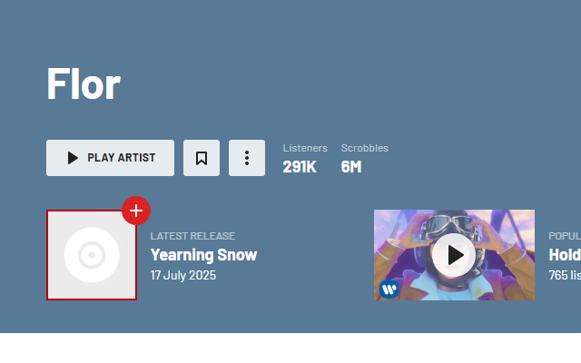
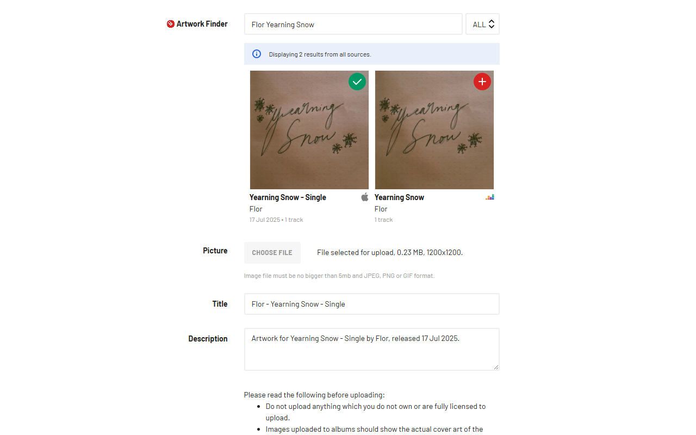
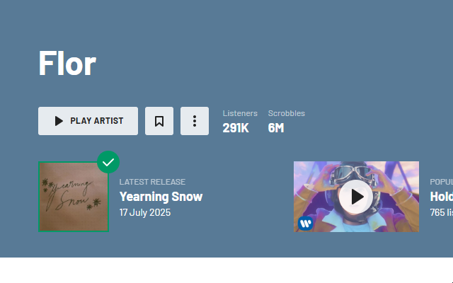
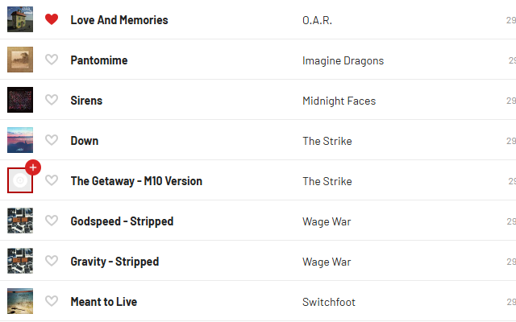
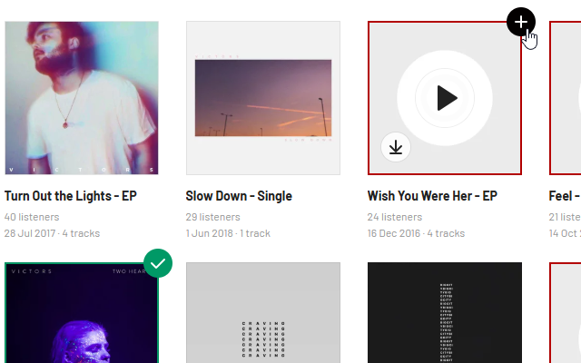

	

<h1>Last.fm Missing Artwork Fixer</h1>

[![Chrome Web Store][WebStoreBadge]][WebStore]
[![Firefox][FirefoxBadge]][Firefox]

Easily identify albums with missing artwork on Last.fm and quickly fix them with an embedded artwork finder.

Help make Last.fm artwork cleaner and more complete for yourself and other Last.fm users, one fix at a time! This extension aims to make fixing artwork as quick and painless as possible.

## Features

📌 On any Last.fm page:
- ✅ Automatically identifies missing artwork and artist images on the Last.fm page you're on.
- ✅ Convenient button takes you directly to the upload page for that album.
- ✅ Extension badge shows you the number of missing artworks on the current page.
- ✅ After you fix the artwork, extension will bring you right back to where you were so you don't miss a beat.

📌 On the Last.fm upload form:
- ✅ Provides an artwork finder, embedded right on the upload form.
- ✅ Finder automatically displays image results for your album for easy selection.
- ✅ If no results from artwork finder, a convenient Google Images link is provided.
- ✅ Auto-attach an album image via direct image link instead of needing to download the image and select it from your computer.
- ✅ Auto-populates Title and Description fields.

📌 On extension popup:
- ✅ View the total number of artworks you've fixed since you installed the extension for some well-deserved recognition for your efforts.
- ✅ View a leaderboard of artworks fixed across users using the extension. This feature is opt-in.
- ✅ All of the functionality above is configurable by clicking on the extension icon.
- ✅ Configurable theme (dark/light/auto) for extension settings pop-up (so you're not blinded when you're fixing artworks at 2am, right?).

Please note that this extension does not bypass any Last.fm systems to upload artwork — it merely provides an aid in the process. You are still responsible for verifying and complying with all Last.fm policies when uploading artwork.

Happy fixing!

## Installation

The extension can be installed directly from the [Chrome Web Store][WebStore], [Firefox][Firefox], or loaded as an unpacked extension.

[WebStoreBadge]: https://img.shields.io/chrome-web-store/v/kcpejefblghgkenipbobdinkjlimpjfe.svg?label=chrome&logo=google-chrome&logoColor=white
[WebStore]: https://chromewebstore.google.com/detail/lastfm-missing-artwork-fi/kcpejefblghgkenipbobdinkjlimpjfe
[FirefoxBadge]: https://img.shields.io/amo/v/last-fm-missing-artwork-fixer.svg?label=firefox&logo=firefox-browser&logoColor=white
[Firefox]: https://addons.mozilla.org/en-US/firefox/addon/last-fm-missing-artwork-fixer/

## Screenshots

## Support

Any questions, issues or ideas, please post them on the Issues tab!